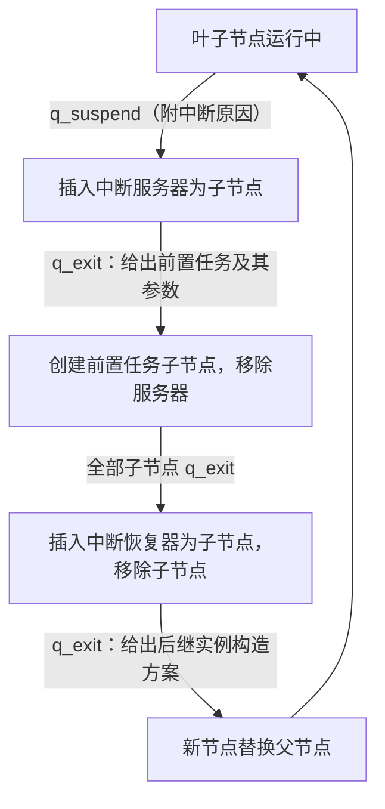

# Layer Cake 项目概述

## 摘要

我们提出了一个智能自动机理论，用来形式化地描述一个 Agent 的行为。同时，我们开发一个名为 Layer Cake 的 Agent 应用开发框架，一方面用于对智能自动机理论进行验证，另一方面，用于构建高效的 Agent 应用。

## 1 理论基础

### 1.1 智能自动机

智能自动机形式化为：
$$
\mathcal{M}=(\text{Model},Q,q_0,q_{exit},\delta)
$$
其格局为：
$$
\mathcal C=(\overrightarrow{\text{{Prompt}}}, q, G)
$$
其中：

- $\text{Model}$ 是模型
- $Q$ 是状态集
- $q_0$ 是初始状态
- $q_{exit}$ 是结束状态
- $\delta:\{\overrightarrow{\text{{Prompt}}}\}\times\{G\}\times Q\to\{\overrightarrow{\text{{Prompt}}}\}\times Q$ 是状态转移函数
- $\overrightarrow{\text{{Prompt}}}$ 是提示词向量
- $q\in Q$ 是当前状态
- $G\sim\operatorname{Gen}(\text{Model},\overrightarrow{\text{{Prompt}}})$ 是模型的当前生成

运行过程如下：

1. 接收初始 $\overrightarrow{\text{Prompt}}$
2. 生成 $G$
3. 计算 $(\overrightarrow{\text{Prompt}'},q')=\delta(\overrightarrow{\text{Prompt}},G,q_0)$
4. 状态转移为 $q'$，使用 $\overrightarrow{\text{Prompt}'}$ 生成 $G'$
5. 直到状态转移为 $q_{exit}$，运行结束。


### 1.2 智能自动机描述经典 Agent 驱动模式

#### 1.2.1 ReAct

ReAct 可形式化为：
$$
\mathcal R=(\text{Model},\{q_{reasoning},q_{exit}\},q_{reasoning},q_{exit},\delta)
$$
其中，$\delta$ 能够执行每一次返回的 $G$ 的 Tool Use 请求，并将 $G$ 的一部分内容，以及 Tool 的返回结果拼接到下一次的提示词中，如果一次 $G$ 不包含 Tool Use 请求，则进入 $q_{exit}$

在大多数工程场景，需要限制 ReAct 的步数，而这也是可以在 $\delta$ 中实现的，步数在 $\delta$ 中硬编码，$\delta$ 可以通过 $\overrightarrow{\text{{Prompt}}}$ 的长度来判定是否提前进入 $q_{exit}$


#### 1.2.2 线性 Workflow

$$
\mathcal W=(\text{Model},Q,q_{task_1},q_{task_n},\delta)
$$

其中：

- $Q=\{q_{task_1},\cdots,q_{task_n}\}$
- $\delta(\cdot,\cdot,q_{task_i})=(\cdot,q_{task_{i+1}}),i=1,\cdots,n-1$

每次执行 $\delta$ 时，$\delta$ 会根据状态，调用不同的解析器解析当前的 $G$，如果需要调用工具，$\delta$ 将会去完成，然后将工具调用的结果拼接到下一次的提示词中。


#### 1.2.3 State-Machine Driven


$$
\mathcal S=(\text{Model},Q,q_0,q_{exit},\delta)
$$

其中，$\delta$ 在构建下一次的提示词时，将本状态能够转移到的其他状态，转移的条件、本状态下的能见内容（如工具集、Skill集）本次 Tool 的返回结果等，来生成下一次的提示词。


### 1.3 结构游戏

图灵机的原始定义为
$$
\mathcal T=(Q,\Sigma,\Gamma,q_0,q_{rej},q_{acc},\delta)
$$
然而，图灵机的变体很多，比如多带图灵机。大部分变体可以通过数学证明其具有与图灵机一致的计算能力，然而，不同的变体则需要不同的机械结构来实现。

出于对图灵机变体的模仿，我提出智能自动机的**结构游戏**，即对智能自动机的原始形式进行改造，然而，由于理论基础的薄弱，以及对“模型生成”：
$$
G\sim\operatorname{Gen}(\text{Model},\overrightarrow{\text{{Prompt}}})
$$
的研究十分不成熟，我们并不追求定义一个智能自动机变体与智能自动机具有一致的计算能力


## 2 工程创意

### 2.1 概述

理论是高度抽象的，但工程必须是具体的。

图灵机就是一个高度抽象的理论，但很多具体的工程化的东西，你都可以说“这本质上是个图灵机”，例如，你可以说“C 语言本质上是个图灵机”、“brainfuck 本质上是个图灵机”、“Haskell 本质上是 Lambda 演算，但邱奇图灵论题指出 Lambda 演算与图灵机具有同样的计算能力，因此 Haskell 本质上是个图灵机”。所以我们追求的一个效果就是，这样一个 Agent 的运行单元，我们可以说，“这本质上是个智能自动机”。

然而，由于理论的缺失，我们实际上只能说“这本质上是智能自动机的原始形式”“这本质上是智能自动机的某某变体”，但至少我们目前可以说，“ReAct 本质上是智能自动机”“Workflow 本质上是智能自动机”。

智能自动机至少有这么几个点带来了高度的抽象性：

- 有限状态集 $Q$；因为我们并不指定状态的具体形式，只要求 $Q$ 是有限可数的，因此，$Q$ 无论是有限个整数、字符串还是结构化对象的集合，都是没问题的。
- 转移函数 $\delta$：它表示的处理逻辑更是千变万化

因此，工程上的东西，可以有“本质上是理论里的某东西”的映射，但也会包含与理论没有什么直接关联的东西。

### 2.2 调度机制

#### 2.2.1 场景案例

如果存在一个依据 Layer Cake 开发的软件开发智能应用，那么，以"帮我修复登录按钮不可点击的 bug"的例子，我所期望的运行过程是这样的：

1. 调度器在 智能自动机蓝图库里找一个实例模板，可能是启发式地选择，也可能是创建一个 智能自动机，由这个 智能自动机来选择，取决于调度器的实现。这个实例很可能是一个无工具的可中断 ReAct 实例，其创建的 智能自动机为 $\mathcal A_0$，然后把用户的原始输入嵌入到 $\mathcal A_0.\overrightarrow{\text{Prompt}}_0$ 中，然后把 $\mathcal A_0$ 给插入到调度树中，显然，此时的 $\mathcal A_0$ 是一个叶子节点。
2. $\mathcal A_0$ 发现需要先定位到相应的代码文件，以及与之相关的设计文档才能工作，且自己没有能够用来做这些工作的工具，于是进入 $q_{suspend}$，并附带中断原因：需要先找到相应的代码文件与和这个按钮有关的记忆。
3. 调度器发现了 $\mathcal A_0$ 的中断格局，且这个中断格局没有任何子节点，于是机械地创建 智能自动机中断服务器 $\mathcal S_0$，并作为 $\mathcal A_0$ 的的叶子节点入树。
4. $\mathcal S_0$ 在 智能自动机蓝图库里找一个擅长读代码的实例和一个专门用来检索记忆的实例（或者二合一），并编辑它们的初始提示词向量，然后进入 $q_{exit}$ 状态。
5. 调度器发现了进入 $q_{exit}$ 状态的 $\mathcal S_0$，知道它是为 $\mathcal A_0$ 服务的，然后以它的最终输出为原料，创建了专门用来读代码的实例 $\mathcal A_1,\mathcal A_2$，然后将 $\mathcal S_0$ 从树中取出，将 $\mathcal A_1,\mathcal A_2$ 入树，并作为 $\mathcal A_0$ 的子节点。
6. $\mathcal A_1,\mathcal A_2$ 找到相应的信息后，进入 $q_{exit}$ 的状态，调度器发现它们后，检查它们的父节点 $\mathcal A_0$ 的所有子节点是否都进入了正常退出状态，如果是的话，机械地创建 智能自动机中断恢复器 $\mathcal R_0$，并作为 $\mathcal A_0$ 的叶子节点，然后将 $\mathcal A_1,\mathcal A_2$ 从树中取出。
7. $\mathcal R_0$ 经过思考，认为 $\mathcal A_0$ 要想完成使命，需要一个 智能自动机蓝图库里的可用于编写代码的 智能自动机，以及 $\mathcal A_1,\mathcal A_2$ 的工作成果。于是构建好了 $\mathcal A_3$ 及其初始格局，然后进入 $q_{exit}$ 状态。
8. 调度器发现了进入 $q_{exit}$ 状态的 $\mathcal R_0$，知道 $\mathcal A_0$ 的中断已经解决，于是从树中移除 $\mathcal R_0,\mathcal A_0$，然后根据 $\mathcal R_0$ 的工作成果，创建 $\mathcal A_3$ 并入树。

#### 2.2.2 调度逻辑
调度器是智能自动机实例的运行底座，它可以是普通图灵机，也可以是一个智能自动机。整个调度体系的语义分工是：

$$
\boxed{\text{调度器保持机械，不承载任何语义判断；分析与构造集中于中断服务器与中断恢复器}}
$$

**调度栈与调度树。** 串行情形下，调度结构是栈：正在运行的格局位于栈顶；父自动机中断后，中断现场入栈，启动前置任务自动机；前置任务进入 $q_{exit}$ 后，中断现场出栈，由调度器重新构造后继实例。栈是一种机械记忆，不需要语义检索。当中断产生多个可以并行执行的子任务时，栈不再足够，调度结构自然扩展为树：

$$
v_p\to\{v_1,\dots,v_k\},\qquad v_1\parallel v_2\parallel\dots\parallel v_k
$$

**机械规则。** 调度器只观察两件事：节点报告的调度生命周期（运行中、已中断、已结束）与节点的角色（工作节点、中断服务器、中断恢复器），据此执行以下固定规则：

1. 让所有叶子节点上的智能自动机保持运行，或限制同时运行的数量；
2. 叶子节点进入中断状态时，构造中断服务器，插入为该节点的子节点；
3. 中断服务器的最终运行结果，是要求调度器为它的父节点创建子节点及其所需参数；
4. 调度器发现作为叶子节点的中断服务器进入结束状态时，为其父节点创建相应的子节点；
5. 一个节点的全部子节点均进入结束状态时，移除所有子节点，构造中断恢复器并插入为该节点的子节点；
6. 中断恢复器综合父节点的目标、中断原因和子节点的运行结果，给出创建一个新节点的计划；
7. 调度器发现作为叶子节点的中断恢复器时，将它与其父节点移除，并按其计划创建新结点，替换父节点。

这条规则不限于工作节点：中断服务器和中断恢复器本身也是智能自动机，它们若中断，对它们递归执行同一规则，不存在"哪类智能自动机允许中断"的特判。

"无需前置任务"不是特殊快捷路径，而是前置任务集合为空。例如，用户询问北京的天气而现有自动机没有天气查询工具：中断服务器的结论是"只需为现有自动机补充一个天气查询工具"，随后进入结束状态；调度器照常机械地插入中断恢复器，服务器的结论自然成为恢复器的工作材料；恢复器据此构造一个复用原自动机全部上下文、仅增加天气查询工具的新实例并替换原节点。整个过程不产生任何子任务实例，调度规则本身不变。

调度树上的循环可以概括为：



**中断后重构。** 中断现场表示为 $\mathcal H=(\mathcal C_t,r)$，其中 $r$ 是中断原因。前置任务结束后，不宜直接从旧格局继续运行，因为中断期间整体工作条件可能已经变化；更合适的是把中断现场作为原材料，结合最新条件与子任务结果重新构造后继实例：

$$
\mathcal H
\xrightarrow[\text{最新条件、子任务结果}]{\text{重新构造}}
(\mathcal M',\mathcal C_0')
$$

$$
\boxed{\text{中断后重构，而不是机械恢复}}
$$

### 2.3 Tool 的分类
按执行语义，Tool 分为两类；面向调度体系，还存在第三类。

**第一类：上下文注入。** 服务于信息获取，如读文件、检索、查询天气。其结果是不透明文本；$\delta$ 对它们有统一的执行入口，把包含 Tool Call 的 `Assistant` 消息与 `Tool` 结果消息追加到当前提示词向量中，运行停留在原状态继续。

**第二类：状态转移。** 服务于状态转移决策。模型以 Tool Use 的形式表达转移意图（如 `suspend(reason)`），$\delta$ 对调用结果进行确切解析，得到类型化的转移指令，再将指令施加到当前状态。这类 Tool 的执行需要格局的可变引用，因为它要自行把结果消息写入提示词向量。

两类工具背后是同一条原则：

$$
\boxed{\text{转移的决策归模型，转移的执行归 }\delta}
$$

由 LLM 主动发起的状态转移，本质上也是由 Tool 完成的。机械转移与模型决策转移可以并存于同一个 $\delta$：ReAct 的"生成中不含 Tool Use 即进入 $q_{exit}$"是前者，`suspend` 是后者。

**第三类：自省 Tool。** 前两类 Tool 服务于工作自动机自身的运行，自省 Tool 服务于调度体系：蓝图为它创建的实例提供形式特定的观察接口，供中断服务器与中断恢复器理解中断现场，例如查询中断前最后一轮输出、当前工具集、当前 Prompt 或其受控摘要、Workflow 的当前步骤、哪些 DSL 参数可用于构造后继实例。自省 Tool 不是把对象的所有字段暴露给模型：`last_generation` 的含义由具体形式决定，工具描述可能包含不应暴露的配置，Prompt 可能包含系统提示词等敏感信息；蓝图需要解释每个查询的意义，并决定哪些内容允许暴露。

另有两条与 Tool 相关的边界：

- MCP 解决的是工具接入问题，不负责约束模型在什么阶段能够使用什么工具；工具的可见性由状态或蓝图管理，例如 SMD 的 $\mathrm{Tools}:Q\to 2^{\mathrm{Tool}}$。
- 全局记忆不做成 Tool：它的读取发生在构造新智能自动机时，写入发生在实例正常结束后，不同于把记忆读写封装成 Tool 交给模型自由调用。

### 2.4 自动机蓝图
按照需求搭建一个智能自动机，至少需要三部分工作：选择自动机的形状（在结构游戏产生的顶层原型中选择一种）、定义状态集及其表示、实现转移函数。形状本身的工程复杂度很高，因此把第一步变成选择题：蓝图库只保留少量经过验证的形式，构造者从中选择，而不是每次重新设计。

由此可以给蓝图一个明确的定义：

$$
\boxed{\text{蓝图是一个从 DSL 到智能自动机的解释器}}
$$

每种形式在蓝图库里注册自己的 DSL：填写 DSL 规定的少量参数，解释器即可产出一个可运行实例。例如：

- 可中断 ReAct 的 DSL：只需填写工具集、最大步数和初始提示词；
- Workflow 的 DSL：需要填写步骤目标、步骤顺序、每步工具集；
- 尽可能自由的字符串状态自动机的 DSL：需要填写状态集、初始状态、中断状态、结束状态、初始提示词，以及以脚本形式给出的转移函数。

蓝图不是自动机形式，蓝图与形式也不是一一对应：ReAct 蓝图与 Workflow 蓝图可以共享同一种自动机对象和格局对象，只是 DSL 与转移函数不同。蓝图 DSL 与运行时现场也不是同一个东西：前者描述"怎样创建实例"，后者描述"实例已经运行到了哪里"；恢复器可以生成新的 DSL，但调度器不负责生成或解析 DSL。工程防护参数（如最大步数）由 DSL 承载，最终落实在具体实例的转移函数中，而不进入运行时核心。

序列化是异构的。Model 引用与生成参数、状态集、初始与结束状态、Tool 定义、Skill 引用、Prompt 模板、初始与中间格局，较容易以 JSON、YAML 等格式保存；$\delta$ 较难序列化，可采用运行时函数引用、声明式转移规则、DSL、脚本或源代码、字节码或 WASM、由底座注册的执行器等方式。序列化的粒度随形式而异：一个 ReAct 实例可能只需填写初始上下文和所需工具，一个 Workflow 实例则需要编写状态集、每状态工具集与转移规则。

蓝图库应当少而精，优先保存由人类专家精心设计、经过实验验证的原型。它保存的是结构原型——可中断、无工具的 ReAct；可中断、允许 `read`、`glob`、LSP 的 ReAct；状态局部提示词 Workflow；用于代码修复的 SMD——而不是"代码专家""测试专家"这类人格化角色。

## 3 工程实现

### 3.1 组件划分

Layer Cake 划分为三层：

```text
发行版
    选择产品能力和用户体验
        ↓
Host
    提供具体自动机语义并填充 Runtime 的插槽
        ↓
layer cake runtime
    只执行调度树的机械规则
```

依赖方向与禁止方向：

```text
发行版 -> Host -> Runtime
Host -> 具体自动机形式、格局、转移函数、蓝图、中断服务器、中断恢复器

Runtime -X-> 具体自动机形式
Runtime -X-> 具体格局形式
Runtime -X-> 蓝图
Runtime -X-> 模型和工具
```

三层各自回答一个不同的问题：Runtime 回答"树如何机械地管理节点"，Host 回答"节点内部是什么语义"，发行版回答"用户拿到的是什么产品"。

理论与三层的亲缘关系需要专门强调：

$$
\boxed{\text{理论与 layer cake runtime 基本无关，与 Host 高度相关}}
$$

第 1 章的所有理论对象——五元组、格局、$\operatorname{Gen}$、结构游戏的形式变体——都物化在 Host 一侧，没有一个理论概念进入 Runtime。这呼应了 2.1 节的判断：Host 里的东西往往能指出"本质上是理论里的某东西"，而 Runtime 属于"与理论没有什么直接关联的东西"，它是纯粹的调度与管理结构。理论实现的一切细节，在运行节点包装完成的那一刻就被整体擦除；Runtime 眼中的节点，只是可以继续运行、会报告生命周期的对象。

当前仓库的 PoC 属于 Host 侧的概念验证，它不是目标 Runtime 的内容：

| PoC 内容 | 在目标架构中的位置 |
| --- | --- |
| `AgentAutomaton<Q, P>` | Host 的一种具体自动机形式 |
| `InterruptibleAgentAutomaton<Q, P>` | Host 的另一种具体自动机形式 |
| `AgentAutomatonConfiguration<E>` | Host 的一种具体格局形式 |
| `TransferFunction` / `InterruptibleTransferFunction` | 具体形式的转移接口 |
| `StepOutcome`、`RunEnding` | Host 与 Runtime 的协议设计材料 |
| `ModelProvider` | Host 的模型适配 |

迁移方向不是把当前 `automata` 模块整体改名为 Runtime，而是从它的运行经验中提取真正形式无关的部分：运行节点的统一边界、生命周期投影、调度树、中断服务器插槽、中断恢复器插槽。


### 3.2 layer cake runtime
Runtime（crate 名 `layer-cake-runtime`）是机械调度边界，即智能自动机树的运行时内核。它与第 1 章的理论基本无关：五元组、格局、$\operatorname{Gen}$、结构游戏的形式变体都不出现在其中；它也不定义任何智能自动机形式和具体格局，只负责：

- 保存调度树；
- 保存每个节点的身份、父子关系、角色和生命周期；
- 让叶子节点继续运行；
- 识别节点进入中断或结束状态；
- 按固定规则启动中断服务器和中断恢复器；
- 把 Host 交给它的新节点放进树，或用新节点替换旧节点。

它对节点内部的全部要求是：这个对象可以继续运行，并且会报告自己目前是 `Running`、`Suspended` 还是 `Exited`。

支撑这套规则的关键概念：

- **运行节点**：已完成类型配对、可以交给 Runtime 调度的自动机实例。Host 先完成（具体自动机，具体格局，具体转移函数）的配对，再整体擦除包装成运行节点；Runtime 不重新配对两个独立的擦除对象，也不要求运行节点拥有 `current_state`、`StandardPromptVector`、`last_generation` 之类的统一字段。
- **树节点**：运行节点在调度树中的身份与位置——节点身份、运行节点、角色、父子关系，以及中断材料与结束结果同节点的关联。运行节点回答"这个实例如何继续运行"，树节点回答"这个实例在调度关系中处于哪里"；父子关系属于调度树，不属于工作自动机的格局。
- **生命周期**：`Running / Suspended / Exited` 三种，分别对应继续运行、启动中断服务器、按角色执行结束规则三条机械分支。具体自动机的内部状态（如 `q_suspend`、`workflow_step_1`）由 Host 投影成这三种生命周期；"等待子任务"由父节点保持 `Suspended` 表示，不引入第四种状态。
- **角色**：`Work / InterruptionServer / InterruptionRecoverer`，决定节点 `Exited` 后执行哪条规则。角色不描述自动机形式：三种角色可由同一种形式实现，也可分别使用完全不同的形式。
- **插槽**：Runtime 不提供具体智能自动机，只提供注入位置。完整调度树必须注入根运行节点、中断服务器插槽、中断恢复器插槽；装配不完整时应拒绝启动，而不是临时猜测替代实现或静默跳过中断流程。

"内核"是职责类比，不是操作系统内核：Layer Cake 与 Host 同处用户态，两者的边界是 Rust 抽象与依赖注入边界，不是权限级别边界。

### 3.3 layer cake host
Host 是具体语义边界，也是理论的落地点：第 1 章的理论与这一层高度相关，五元组与六元组、格局、转移函数、结构游戏产生的形式变体，全部物化在 Host 中。Host 负责把 Runtime 的空调度机制填充成一套具体系统，它定义：

- 自动机形式与格局形式：当前 PoC 的 `AgentAutomaton` 与 `InterruptibleAgentAutomaton` 是两个平行谱系（结构游戏的产物），共享 `AgentAutomatonConfiguration`，未来的多槽提示词等形式将单开谱系；
- 转移函数：`TransferFunction` 与 `InterruptibleTransferFunction`，以及 ReAct 实例 `ReActTransfer`、`InterruptibleReActTransfer`；
- 模型与工具：`ModelProvider` 适配（OpenAI 兼容），上下文注入与状态转移两类 Tool，内置的 `SuspendTool`；
- 蓝图及其 DSL 解释器，以及蓝图的自省 Tool；
- 中断服务器与中断恢复器的具体实现——它们本身也是智能自动机，形式由 Host 选择，很可能需要新的形式变体（如多槽提示词智能自动机）；
- 如何把恢复器的决定物化为已完成类型配对的新运行节点。

中断材料的解释也发生在 Host：Runtime 只保存和转交节点身份、树位置与关联的不透明材料，由 Host 通过自省 Tool 或其他观察能力把它们交给服务器与恢复器。

当前 PoC 状态：双谱系自动机、两类工具、`SuspendTool` 已落地并通过单元测试；蓝图、自省 Tool、中断服务器与中断恢复器、调度树尚待实现。

### 3.4 发行版
发行版是在 Host 之上提供给具体用户的软件，是产品边界。它可以增加：

- 领域蓝图库；
- 模型配置；
- 工具；
- 用户界面；
- 权限和账户；
- 持久化；
- 面向代码、研究、审批或其他领域的产品流程。

发行版是否通用，不由 Runtime 决定——Runtime 甚至不知道一个发行版是通用 Agent 还是领域专精 Agent。发行版的通用性来自它组合了多少蓝图、工具和界面，而不是内核预装了多少功能；Layer Cake 只需提供可供界面消费的观察协议，不需要知道界面长什么样。

产品策略层的决定都属于发行版：哪些模型可用、哪些工具允许调用、中断服务器和恢复器采用什么模型、是否允许用户编辑 DSL、如何持久化运行记录。
