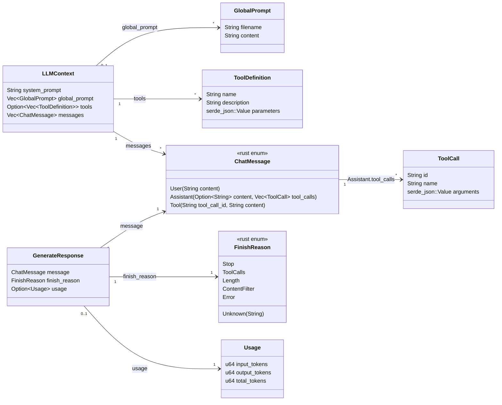

# LLM API 的工程化数据建模

我这样建模 LLM API

这个数据建模，是通过对 OpenAI 的 chat/completions API、Anthropic messages API、Gemini API 的分析，给出的一个能够与这三种主流 API 格式分别建立一一映射的 IR，并且它基本上足够用来指导许多 Agent 应用的开发。

其中，`LLMContext` 是对于一次完整的 LLM API 请求的封装，它里面的参数足以用于完成一次完整的请求，其中包含四部分内容：

- `system_prompt`：系统提示词，它通常是单来源、运行时不可变的提示词。
- `global_prompt`：全局提示词，它通常是多来源，运行时可变的提示词。
- `tools`：LLM API 可见的 Tool 的集合
- `messages`：LLM API 可见的对话记录

`GenerateResponse` 就是 LLM API 的返回，其中：

- `message` 的具体类型通常是 `ChatMessage::Assistant`，包含模型生成的回答内容和 Tool Use 内容
- `finish_reason` 表示模型停止生成的原因，而在 `FinishReason` 中列举的停止生成的原因有：
  - `Stop` 正常结束
  - `ToolCalls` 因为需要 Tool Use 而暂停
  - `Length` 因为 Token 生成量超过了最大值而暂停生成
  - `ContentFilter` 因为触发了内容过滤机制而暂停生成
  - `Error` 因为网络、API Key 无效等“偶然复杂度”性质的错误而停止生成
  - `Unknown` 因为未知原因而停止生成
- `usage` 记录了此次生成的 token 消耗情况

所以我们可以看到，`ChatMessage` 是一个核心的记录对象，任何来自用户、工具调用、模型回复的记录，都会作为一个 ChatMessage 对象受到维护。